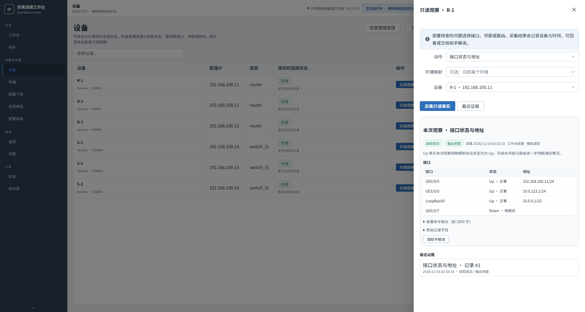

# IP 仿真运维管理工作台

面向网络运维初学者的 Windows 工作台。从首页「入门巡检」开始，查看拓扑、记录一条接口观察并保存到实训历史。继续学习时可通过课程步骤打开教材对应页，或请右侧助手解释步骤和证据。

**V7.0 增量候选** · [Windows 快速启动](#windows-快速启动) · [首次验收](#首次验收) · [启动与接管指南](启动与验收.md)

## 界面预览

截图来自本地模拟实训环境，点击图片可查看原尺寸。

[](docs/images/workbench/dashboard.png)

| 拓扑与链路 | 设备只读观察 |
| --- | --- |
| [](docs/images/workbench/topology.png) | [](docs/images/workbench/device-observation.png) |

| WebSSH 终端 | 终端内打开实训会话 |
| --- | --- |
| [](docs/images/workbench/webssh.png) | [](docs/images/workbench/training-session.png) |

| 实训课程目录 | 知识库目录 |
| --- | --- |
| [](docs/images/workbench/training-courses.png) | [](docs/images/workbench/knowledge.png) |

## Windows 快速启动

准备 Git、Windows x64 版 Python 3.12 和 PowerShell 7。在启动所用的 PowerShell 中，先用 `py -3.12 --version` 或 `python --version` 确认能找到 Python 3.12。首次启动需要可用的 Python 包安装源，或按启动指南使用离线依赖。仓库附带预构建网页，最小模式使用 SQLite、六台模拟设备和本地知识库。

```powershell
git clone https://github.com/murd3r17/ip-sim-workbench.git
Set-Location .\ip-sim-workbench
pwsh -NoProfile -File .\scripts\bootstrap-local.ps1 -Mode minimal
```

脚本就绪后打开 [本机工作台](http://127.0.0.1:8000)。在仓库根目录的 `.env` 查看首次生成的 `ADMIN_USERNAME` 和 `ADMIN_PASSWORD`，登录后进入「工作台」。8000 端口有占用时，在启动命令末尾加 `-BackendPort 18080`，按脚本打印的地址访问。

## 首次验收

1. 在「工作台」核对六台设备和五条链路。点「打开拓扑页」，选择一条链路查看两端接口。
2. 进入「设备」，对 R-1 点「只读观察」→「采集只读事实」，查看接口状态和采集时间。也可以在「终端」连接 R-1，输入 `display interface brief` 查看回显。
3. 回首页点「入门巡检」和「开始巡检」。按提示记录设备、接口、状态和观察时间，点「保存笔记/步骤」。在终端页点右上角「实训进行中」，可原地查看或编辑会话，关窗后继续使用终端。
4. 进入「知识库」，用 `OSPF` 筛选资料并打开一个章节。本机可阅读和检索随仓库提供的整理稿。挂载获授权的同版教材资产后，也可从实训步骤和助手引用打开对应正文与可用原图。
5. 管理员可在「系统管理」的「账号管理」创建或重置普通账号。学员从右上角账号菜单修改自己的密码。

## 接管与扩展

| 接下来要做的事 | 入口 |
| --- | --- |
| 停止或重启本地服务，处理首跑、登录和备份 | [启动与验收](启动与验收.md) |
| 使用设备管理、监控告警、配置审批、版本与回退 | [用户手册](docs/guides/用户手册.md) |
| 接入自有模型或获授权的本地教材目录 | [开启对话助手](启动与验收.md#开启对话助手) · [自有教材目录](启动与验收.md#自有教材目录) |
| 配置 MySQL、真实 SSH 设备和联网知识服务 | [完整模式首次配置与启动](docs/guides/full模式首次配置与启动.md) |
| 核对依赖、扫描交付文件、生成接收方副本 | [交付检查与隔离打包](docs/guides/交付检查与隔离打包.md) |

当前增量候选在 Windows 本地模拟环境验证了入门巡检、笔记保存与复盘回读、模型配置、典型审批流程以及独立 Edge 的全屏、窗口变化和 200% 键盘操作。真实设备联调与变更恢复、接收方独立部署及真人上手分别验收。

前端位于 `sim-frontend`，使用 Vue 3、TypeScript 和 Vite。后端位于 `backend`，使用 FastAPI、SQLAlchemy 和 Alembic。前后端检查可在 GitHub Actions 查看。运维基础继承自原工作台项目。[CI](https://github.com/murd3r17/ip-sim-workbench/actions/workflows/ci.yml) · [上游项目](https://github.com/drongzsy/probable-meme)

反馈问题时请附启动方式、复现步骤、预期和实际结果，以及有助于定位的脱敏截图或日志。[反馈问题](https://github.com/murd3r17/ip-sim-workbench/issues/new)
