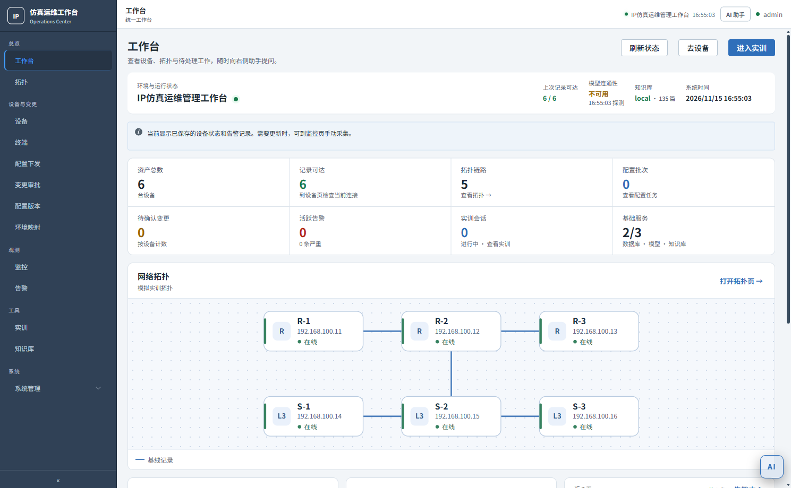
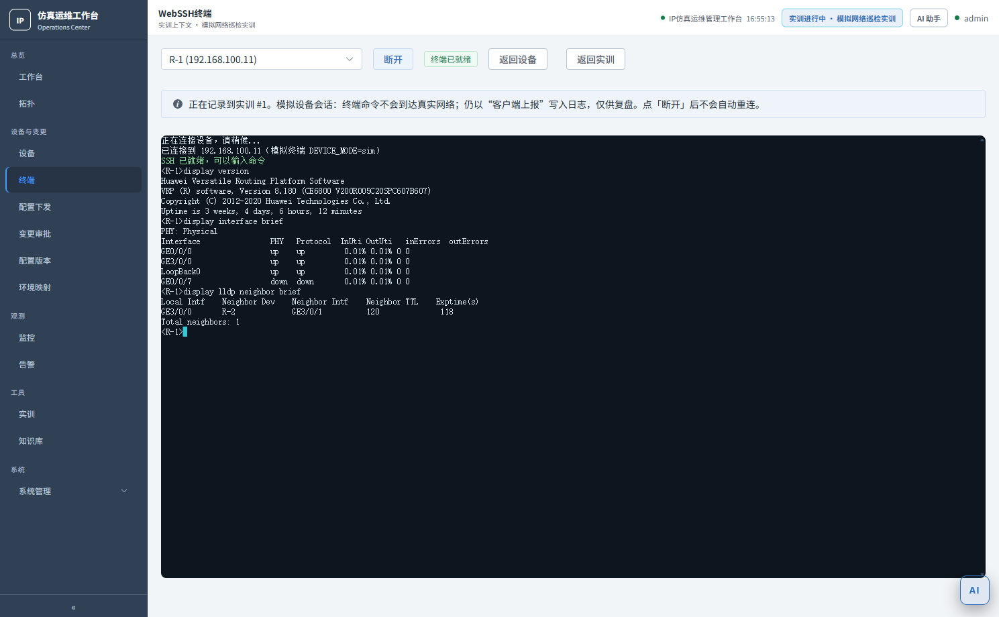
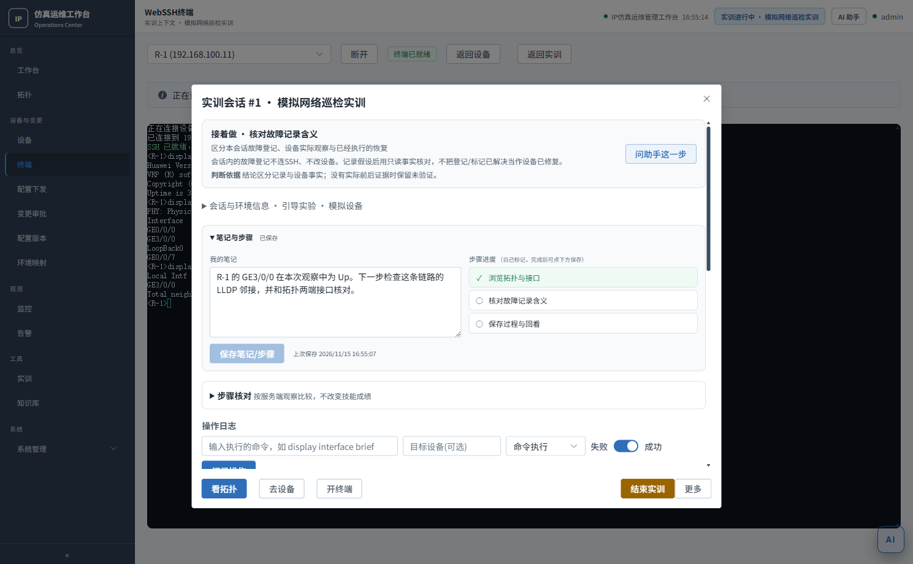
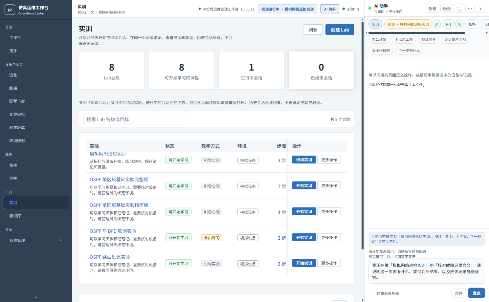

# IP 仿真运维管理工作台

面向网络运维初学者的 Windows 工作台。打开拓扑找设备，采集接口、邻居及路由证据，再把观察结果记进实训会话。右侧助手可结合当前页面、设备和教材回答问题。

**V7.0 本地模拟候选** · [Windows 快速启动](#windows-快速启动) · [首次验收](#首次验收) · [启动与接管指南](启动与验收.md)

## 界面预览

截图来自本地模拟实训环境，点击图片可查看原尺寸。

[](docs/images/workbench/dashboard.png)

| 拓扑与链路详情 | 设备只读观察 |
| --- | --- |
| [](docs/images/workbench/topology.png) | [](docs/images/workbench/device-observation.png) |

| WebSSH 终端 | 终端内打开实训会话 |
| --- | --- |
| [](docs/images/workbench/webssh.png) | [](docs/images/workbench/training-session.png) |

| 实训课程与 AI 助手 | 知识库目录 |
| --- | --- |
| [](docs/images/workbench/training-courses.png) | [](docs/images/workbench/knowledge.png) |

## Windows 快速启动

准备 Git、Windows x64 版 Python 3.12 和 PowerShell 7。首次启动需要可用的 Python 包安装源。仓库附带预构建网页，最小模式使用 SQLite、六台模拟设备和本地知识库。

```powershell
git clone https://github.com/murd3r17/ip-sim-workbench.git
Set-Location .\ip-sim-workbench
pwsh -NoProfile -File .\scripts\bootstrap-local.ps1 -Mode minimal
```

脚本就绪后打开 [本机工作台](http://127.0.0.1:8000)。在仓库根目录的 `.env` 查看首次生成的 `ADMIN_USERNAME` 和 `ADMIN_PASSWORD`，登录后进入「工作台」。8000 端口有占用时，在启动命令末尾加 `-BackendPort 18080`，按脚本打印的地址访问。

## 首次验收

1. 在「工作台」核对六台设备和五条链路。点「打开拓扑页」，选择一条链路查看两端接口。
2. 进入「设备」，对 R-1 点「只读观察」→「采集只读事实」，查看接口状态和采集时间。也可以在「终端」连接 R-1，输入 `display interface brief` 查看回显。
3. 从「实训」开始「模拟网络巡检实训」。写一条观察并点「保存笔记/步骤」。在终端页点右上角「实训进行中」，可在原页打开会话，关窗后继续使用终端。
4. 进入「知识库」，用 `OSPF` 筛选资料并打开一个章节。随仓库提供的 135 篇整理正文可直接在本机阅读和检索。

## 接管与扩展

| 接下来要做的事 | 入口 |
| --- | --- |
| 停止或重启本地服务，处理首跑、登录和备份 | [启动与验收](启动与验收.md) |
| 使用设备管理、监控告警、配置审批、版本与回退 | [用户手册](docs/guides/用户手册.md) |
| 接入自有模型或获授权的本地教材目录 | [开启对话助手](启动与验收.md#开启对话助手) · [自有教材目录](启动与验收.md#自有教材目录) |
| 配置 MySQL、真实 SSH 设备和联网知识服务 | [完整模式首次配置与启动](docs/guides/full模式首次配置与启动.md) |
| 核对依赖、扫描交付文件、生成接收方副本 | [交付检查与隔离打包](docs/guides/交付检查与隔离打包.md) |

当前候选已验证 Windows 本地首跑、模拟拓扑与终端、八门实训、笔记保存与续读，以及代表性 SQLite 旧库升级。真实设备联调和变更恢复、接收方独立部署及真人上手还在后续验收范围。

前端位于 `sim-frontend`，使用 Vue 3、TypeScript 和 Vite。后端位于 `backend`，使用 FastAPI、SQLAlchemy 和 Alembic。前后端检查可在 GitHub Actions 查看。运维基础继承自原工作台项目。[CI](https://github.com/murd3r17/ip-sim-workbench/actions/workflows/ci.yml) · [上游项目](https://github.com/drongzsy/probable-meme)

反馈问题时请附启动方式、复现步骤、预期和实际结果，以及有助于定位的脱敏截图或日志。[反馈问题](https://github.com/murd3r17/ip-sim-workbench/issues/new)
